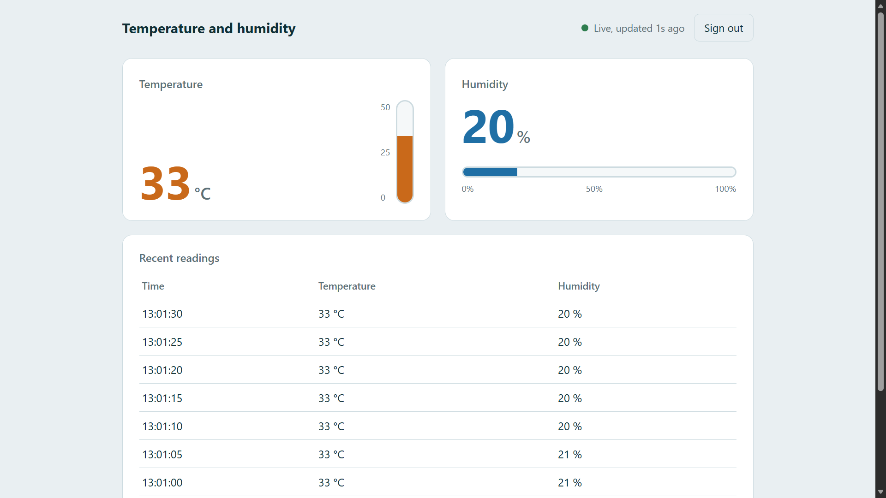
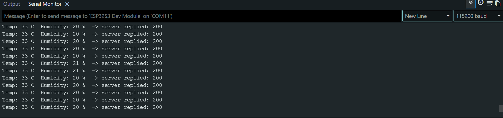
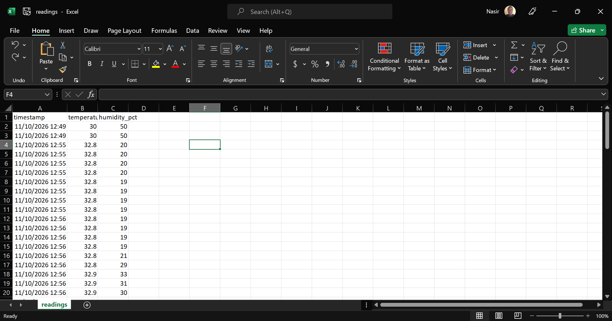
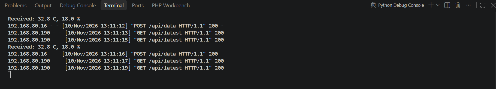

# ESP32-S3 Temperature and Humidity Monitor

A local IoT system that measures temperature and humidity with an **ESP32-S3** and a **DHT11** sensor, sends the readings over Wi-Fi to a **Flask** server, and shows them live on a **login-protected web dashboard**. Every reading is also saved to a CSV file.



## Introduction

Temperature and humidity are among the most commonly monitored environmental quantities. This project shows the full path of an IoT data pipeline on a small scale: a sensor is read by a microcontroller, the data travels over Wi-Fi to a server, and a user sees it in a browser. Everything runs on a local network, so no internet connection and no cloud account are needed.

I built it during my SIWES (industrial training) as a hands-on project in embedded systems, networking and web development.

## Features

- Reads temperature and humidity every 5 seconds with a DHT11 sensor
- Sends readings to the server over Wi-Fi as JSON (HTTP POST)
- Login-protected dashboard with live gauges for temperature and humidity
- Status indicator that shows whether the device is still sending data
- Table of the most recent readings
- Every reading saved to `readings.csv` for later analysis in Excel or Python
- Device key so that only your ESP32 can send data to the server
- Passwords and keys kept in separate files that are never uploaded to GitHub

## Real-life applications

- **Server rooms and labs:** watch heat and humidity without relying on the internet
- **Greenhouses and farms:** track growing conditions
- **Poultry houses and storage rooms:** protect animals, grain and goods
- **Hospitals and pharmacies:** monitor the storage environment for medicines
- **Homes and offices:** comfort monitoring and smart-building projects

## Hardware

| Part | Notes |
|---|---|
| ESP32-S3 development board | Tested on an ESP32-S3 N16R8 |
| DHT11 temperature and humidity sensor | 3-pin module, or 4-pin sensor with a 10 kΩ pull-up resistor |
| Breadboard, jumper wires, USB-C cable | |
| A computer to run the server | Windows, macOS or Linux with Python 3 |

### Wiring

| DHT11 pin | ESP32-S3 pin |
|---|---|
| VCC (+) | 3.3V |
| DATA (OUT) | GPIO 4 |
| GND (-) | GND |

> On the ESP32-S3 N16R8, avoid GPIO 35, 36 and 37 because the octal PSRAM and flash use them.

## How it works

```
DHT11 --> ESP32-S3 --Wi-Fi (HTTP POST, JSON)--> Flask server --> Dashboard in the browser
                                                     |
                                                     +--> readings.csv
```

1. The ESP32 reads the sensor and sends `{"temperature": 33.0, "humidity": 20.0}` to `/api/data`, with the device key in the `X-API-KEY` header.
2. The server checks the key, stores the reading in memory and appends it to `readings.csv`.
3. The dashboard page asks `/api/latest` every 2 seconds and updates the display.

## Project structure

```
esp32-temp-humidity-dashboard/
├── app.py                      Flask server
├── config.example.py           Copy to config.py and edit (not uploaded)
├── requirements.txt            Python dependency (Flask)
├── templates/
│   ├── login.html              Sign-in page
│   └── dashboard.html          Live dashboard
├── esp32_dht11_local/
│   ├── esp32_dht11_local.ino   ESP32 sketch
│   └── secrets.example.h       Copy to secrets.h and edit (not uploaded)
└── docs/                       Screenshots
```

## Getting started

### 1. Get the code

```bash
git clone https://github.com/YOUR-USERNAME/esp32-temp-humidity-dashboard.git
cd esp32-temp-humidity-dashboard
```

### 2. Set up the server

```bash
pip install -r requirements.txt
```

Copy `config.example.py` to `config.py` and change the values:

```python
USERNAME = "admin"
PASSWORD = "your-own-password"
DEVICE_KEY = "your-own-device-key"
SECRET_KEY = "any-long-random-text"
```

Start the server:

```bash
python app.py
```

When Windows asks about the firewall, allow Python on **Private networks**. Then open <http://localhost:5000> and sign in.

### 3. Find your computer's IP address

The ESP32 cannot use `localhost`, because on the ESP32 that means the ESP32 itself. Use the computer's address on your Wi-Fi network:

- Windows: run `ipconfig` and read the **IPv4 Address** of the Wi-Fi adapter
- macOS or Linux: run `ifconfig` or `ip a`

### 4. Set up the ESP32

1. In Arduino IDE, install the **DHT sensor library** (Adafruit) and **Adafruit Unified Sensor** from the Library Manager.
2. In the `esp32_dht11_local` folder, copy `secrets.example.h` to `secrets.h` and fill in your Wi-Fi name, Wi-Fi password, server URL and device key. The device key must be the same as `DEVICE_KEY` in `config.py`.
3. Select the board settings:
   - Board: **ESP32S3 Dev Module**
   - Flash Size: **16MB**
   - PSRAM: **OPI PSRAM**
   - USB CDC On Boot: **Disabled** (use the USB-UART port)
4. Upload the sketch and open the Serial Monitor at **115200 baud**.

You should see a line like this every 5 seconds, and the dashboard will switch to **Live**:

```
Temp: 33 C  Humidity: 20 %  -> server replied: 200
```



## Saved data

Every reading is appended to `readings.csv`, which opens directly in Excel:



And the server prints each accepted reading:



## API endpoints

| Method | Path | Access | Purpose |
|---|---|---|---|
| POST | `/api/data` | `X-API-KEY` header | ESP32 sends a reading |
| GET | `/api/latest` | Logged-in user | Latest reading and the last 10 readings |
| GET | `/dashboard` | Logged-in user | Dashboard page |
| GET, POST | `/login` | Public | Sign-in page |
| GET | `/logout` | Public | Sign out |

## Troubleshooting

| Problem | What to check |
|---|---|
| Serial Monitor stays on `Connecting to Wi-Fi......` | Wrong Wi-Fi name or password. The ESP32 works only on **2.4 GHz** Wi-Fi, not 5 GHz. |
| `server replied: -1` | The ESP32 cannot reach the computer. Check the IP in `SERVER_URL`, that both are on the same Wi-Fi, and that the firewall allows Python on your network type. |
| `server replied: 403` | `DEVICE_KEY` in `secrets.h` and `config.py` do not match. |
| `server replied: 404` | `SERVER_URL` must end with `:5000/api/data`. |
| Dashboard says "Waiting for data" | The server is running but no reading has arrived yet. Check the Serial Monitor. |
| `Failed to read from DHT11 sensor!` | Check the wiring and the pull-up resistor (bare sensors only). |
| Boot loop or garbage on the Serial Monitor | Check the board settings above and try a different USB cable or port. |

## Limitations

- The DHT11 measures 0 to 50 °C (±2 °C) and 20 to 80 % humidity (±5 %), in whole numbers. Readings near the limits, such as very dry air, are the least reliable. A DHT22 or SHT31 would be more accurate.
- The recent-readings list is kept in memory and is cleared when the server restarts. The CSV file is kept.
- The server uses plain HTTP and one shared login, which is fine for a trusted local network but not for the open internet.
- The server is reachable only while the computer is on and running `app.py`.

## Security notes

- Never upload `config.py` or `secrets.h`. They are listed in `.gitignore`.
- Change the default username, password and device key before using the project.
- If you ever commit a real password or key by mistake, change it immediately.

## Future improvements

- History graph of temperature and humidity
- Alerts or a buzzer when the temperature passes a limit
- Relay output to switch a fan automatically
- Run the server on a Raspberry Pi so the laptop is not needed
- Upgrade to a DHT22 or SHT31 sensor

## Author

**Nasir Auwal Aliyu**, B.Tech Electrical and Electronics Engineering student at the Federal University of Technology, Babura (FUTB), Nigeria.
LinkedIn: <https://www.linkedin.com/in/nasirauwalaliyu>

## License

Released under the [MIT License](LICENSE).
